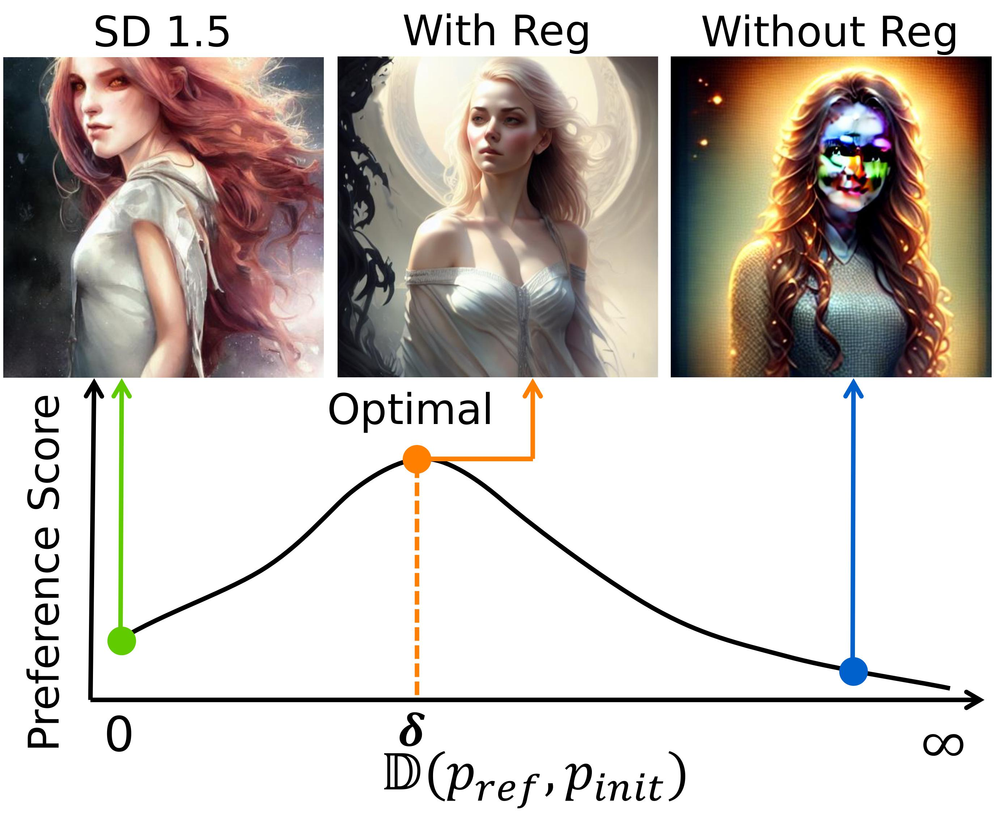

# Intro

This is the official implementation of the paper [Rethinking Direct Preference Optimization in Diffusion Models](https://arxiv.org/abs/2505.18736). This repository is adapted from the [Diffusion-DPO official implementation](https://github.com/SalesforceAIResearch/DiffusionDPO/tree/main)



# Setup

`pip install -r requirements.txt`

# Model Training
bash launchers/run_sd.sh

## Algorithm Hyperparameters

- `--beta_dpo` (implicit) KL-divergence parameter beta for DPO
- `REF_UPDATE_STEP` Update period for the reference model
- `MONITOR_THRESHOLD` Monitoring threshold for the KL divergence between the reference model and the pre-trained model
- `--timestep_gamma` The timestep sampling distribution parameter $\gamma$ 
- `--reward_scale_scheduling` To use the reward scale scheduling
- `--alpha` The hyperparameter for the reward scale scheduling

# Citation

```
@misc{kang2025rethinkingdirectpreferenceoptimization,
      title={Rethinking Direct Preference Optimization in Diffusion Models}, 
      author={Junyong Kang and Seohyun Lim and Kyungjune Baek and Hyunjung Shim},
      year={2025},
      eprint={2505.18736},
      archivePrefix={arXiv},
      primaryClass={cs.CV},
      url={https://arxiv.org/abs/2505.18736}, 
}

```